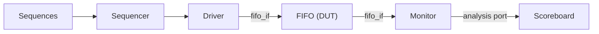

# UVM Verification of a Synchronous FIFO

A parameterizable synchronous FIFO in SystemVerilog, verified with a self-checking UVM testbench. The environment drives random and directed traffic, compares every read against a reference model, and reports pass/fail with coverage-style counters.

## Design

- 8-bit data, 16-deep FIFO (`DATA_WIDTH` and `DEPTH` are parameters; `DEPTH` must be a power of 2)
- Synchronous active-high reset
- `full` and `empty` flags driven by an element counter
- Registered read data (`dout` is valid one cycle after a read is accepted)
- Write has priority if `wr` and `rd` are asserted in the same cycle

## Verification Environment

Standard UVM structure:

| Component | Purpose |
|---|---|
| `transaction` | Sequence item carrying the operation, data and observed flags |
| `fifo_rand_seq` | 50 random read/write transactions with random data |
| `fifo_fill_drain_seq` | Directed test: 20 writes into a 16-deep FIFO, then 20 reads, to hit the full and empty cases |
| `fifo_driver` | Resets the DUT and drives single-cycle read/write pulses through a virtual interface |
| `fifo_monitor` | Samples the DUT pins and sends transactions to the scoreboard through an analysis port |
| `fifo_scoreboard` | Queue-based reference model that checks every accepted read and counts full/empty events |
| `fifo_agent`, `fifo_env`, `fifo_test` | Wire the components together and run the sequences |



## Files

```
FIFO.sv      # FIFO module and fifo_if interface
FIFO_tb.sv   # UVM testbench (transaction, sequences, driver, monitor,
             # scoreboard, agent, env, test, top-level tb)
```

## How to Run

Tested with Questa Altera Starter FPGA Edition 2025.3 (built-in UVM 1.1d).

```bash
vlib work
vlog -sv FIFO.sv FIFO_tb.sv
vsim -c tb -do "run -all; quit"
```

Save the log to a file with `vsim -c tb -l results.txt -do "run -all; quit"`. A waveform is written to `dump.vcd`.

The Starter edition has no license for `randomize()`, so the sequences use `$urandom_range` by default. On a simulator that supports it, compile with `+define+USE_RANDOMIZE` to use constrained-random stimulus.

## Results

```
Writes accepted:37  Reads checked:37  Writes-while-full:11  Reads-while-empty:5
TEST PASSED : Error Count 0
UVM_ERROR : 0    UVM_FATAL : 0
```

Every accepted write was read back in the correct order, and both the full and empty corner cases were exercised.

## Author

Hilay, B.Tech. Electrical Engineering (VLSI), IIT Tirupati
[hilay020905.github.io](https://hilay020905.github.io)
